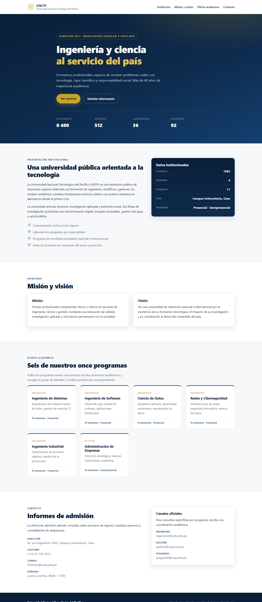
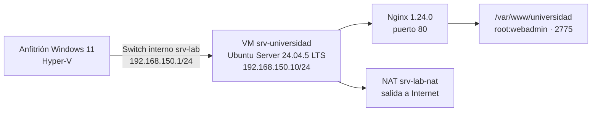

# Servidor web con Ubuntu Server y Nginx

Actividad práctica del curso **Taller de construcción de software web** — Grupo 04.
Implementación de un servidor web completo sobre una máquina virtual con Ubuntu Server:
instalación, configuración de red, publicación de un sitio con Nginx, administración de
usuarios y permisos, supervisión de recursos, copias de seguridad y pruebas de
restauración.



---

## Datos académicos

| Campo | Detalle |
|---|---|
| Universidad | Universidad Nacional Mayor de San Marcos (UNMSM) |
| Facultad | Facultad de Ingeniería de Sistemas e Informática (FISI) |
| Escuela profesional | Ingeniería de Software - Lima |
| Asignatura | Taller de construcción de software web |
| Docente | Candela Arce, David Felix |
| Grupo | 04 |

**Integrantes**

- Joshua Nicolas Chavez Cerna
- Guevara Chávez Luis Rodrigo *(coordinador)*
- Montes Ramos Carol
- Toro Vargas Karlo Andrés
- Núñez Cardenas Ivan Joaquin

---

## Arquitectura



| Elemento | Valor |
|---|---|
| Hipervisor | Hyper-V nativo (VM de generación 2) |
| Sistema operativo | Ubuntu Server 24.04.5 LTS |
| Imagen | `ubuntu-24.04.5-live-server-amd64.iso` |
| Hostname | `srvuniversidad` |
| Red interna | `srv-lab` — 192.168.150.0/24 |
| Red NAT | `srv-lab-nat` |
| Anfitrión | 192.168.150.1 |
| Servidor | 192.168.150.10 |
| Servidor web | Nginx 1.24.0, puerto 80 |
| Recursos de la VM | 2 vCPU, 4 GB de RAM, 20 GB de disco |
| Sitio publicado | `/var/www/universidad` |

---

## Fases de la práctica

| Fase | Contenido | Evidencia |
|---|---|---|
| 1 | Creación de la VM e instalación de Ubuntu Server | `scripts/f1-*.ps1`, `00-documentacion/fase1*.md` |
| 2 | Red estática con netplan y unificación del hostname | `00-documentacion/informe.md` §5 |
| 3 | Instalación de Nginx y publicación del sitio | `scripts/fase3-nginx.sh`, `sitio/` |
| 4 | Usuarios, grupos y permisos (2775 / 0664, sin 777) | `scripts/fase4-usuarios.sh` |
| 5 | Supervisión de CPU, memoria, disco y servicio | `scripts/fase5-monitoreo.sh` |
| 6 | Copia de seguridad con SHA-256 y restauración probada | `scripts/fase6-backup.sh` |
| 7 | Pruebas finales y consolidación de evidencias | `scripts/fase7-evidencias.sh` |

---

## Estructura del repositorio

```
.
├── 00-documentacion/     Informe en Markdown, DOCX y PDF; bitácora y registros de la Fase 1
├── 01-capturas/          Capturas reales del sitio y de las sesiones SSH
├── scripts/              Scripts de automatización (PowerShell para Hyper-V, Bash para el servidor)
└── sitio/                Contenido publicado: index.html, estilos.css y favicon.svg
```

## Documentos entregables

- `00-documentacion/Informe - Servidor Web Ubuntu y Nginx - G4.docx` — informe editable (20 páginas).
- `00-documentacion/Informe - Servidor Web Ubuntu y Nginx - G4.pdf` — copia en PDF.
- `00-documentacion/informe.md` — fuente del informe, usada para generar el DOCX.

## Resultados verificados

| Prueba | Resultado |
|---|---|
| `GET /` desde el anfitrión | `HTTP 200` — 9085 bytes |
| `GET /estilos.css` | `HTTP 200` |
| `GET /no-existe` | `HTTP 404` |
| `nginx -t` | sintaxis correcta |
| Servicio Nginx | `active (running)` y `enabled` |
| Permisos del sitio | directorio `2775`, archivos `0664`, propietario `root:webadmin` |
| Copia de seguridad | integridad SHA-256 `OK` |
| Restauración | `403` tras eliminar `index.html`, `200` tras restaurar |

## Reproducción

Los scripts de la Fase 1 se ejecutan en el anfitrión con PowerShell e Hyper-V habilitado.
Los scripts de las fases 3 a 7 se copian al servidor y se ejecutan con `sudo`:

```bash
scp scripts/fase3-nginx.sh srvadmin@192.168.150.10:/tmp/
ssh srvadmin@192.168.150.10
sed -i 's/\r$//' /tmp/fase3-nginx.sh
sudo bash /tmp/fase3-nginx.sh
```

Para regenerar el informe en Word:

```powershell
python scripts/generar_docx.py
```

Requiere `pandoc` y `python-docx`.

---

## Notas

- Ningún directorio ni archivo del sitio utiliza permisos `777`.
- Las credenciales y claves no se incluyen en el repositorio.
- Las capturas corresponden a la ejecución real de la práctica en el equipo del grupo.
